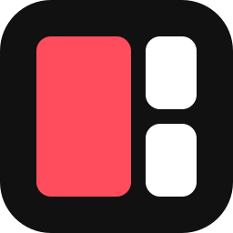

<p align="center">
  
</p>

<h1 align="center">SplitDeck</h1>

A local media player with up to **8 players on one screen**. It shows only the video: no chat, no side bars, no clutter.

Works with YouTube, TikTok LIVE, Twitch, Kick, X and Facebook (best effort), and most sites supported by [yt-dlp](https://github.com/yt-dlp/yt-dlp).

## Features

- Up to 8 players. A player only exists when you add it, so there are no empty slots.
- Many layouts per player count. Drag a player's handle onto another to swap places.
- Drag the dividers between players to resize them.
- Per-player volume, mute and solo, plus a toolbar with speed, quality and captions.
- A built-in "Live now" browser with search, language and category filters.
- Your setup is remembered between sessions.
- Works on phones and tablets, with touch controls.

## Quick start

Requires [Node.js](https://nodejs.org) 18 or newer. No other dependencies.

```bash
npm run setup   # downloads yt-dlp (one time)
npm start       # starts SplitDeck
```

Then open <http://localhost:8787>.

On Windows you can double-click `start.bat` instead. It does both steps and opens your browser.

## Usage

1. Paste a link in the top bar and press **Enter**.
2. Hover a player for its controls.
3. Use **Layout** to pick an arrangement and **Live** to browse what is live.
4. Press **H** to hide the top bar.

## AI Disclosure
This application was built using AI assistance. 
While the logic and scaffolding were generated by AI, the architecture, prompt engineering, and final reviews were guided by a human.

## Documentation

See [docs/DOCUMENTATION.md](docs/DOCUMENTATION.md) for the full guide: all controls, the Live browser, configuration, the HTTP API, how it works, and troubleshooting.
